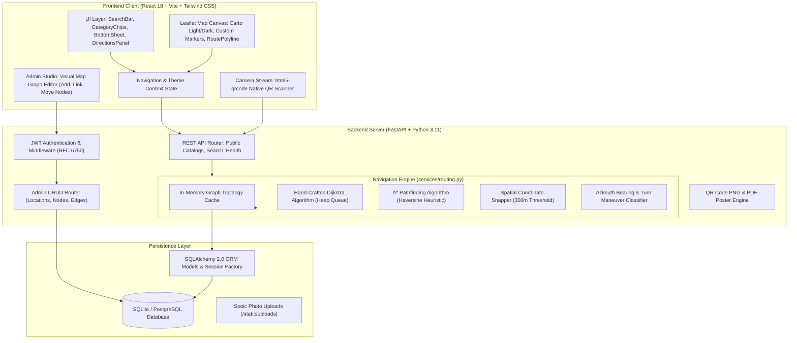
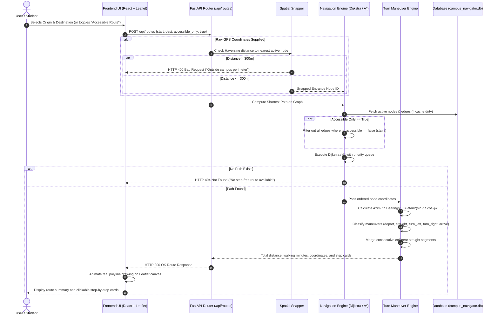

# Campus Navigator — System Architecture & Design

This document details the architectural design, component interactions, and algorithmic principles of the Campus Navigator wayfinding platform.

---

## 1. High-Level System Architecture

Campus Navigator is architected as a decoupled, modern full-stack web application with strict separation between user presentation, business logic, routing computation, and persistent storage:

---

## 2. Navigation & Routing Sequence Flow

The following sequence illustrates the turn-by-turn routing process from user query to animated map visualization:

---

## 3. Algorithmic Principles & Formulas

### 3.1 Haversine Great-Circle Distance
To measure accurate path lengths and distances between geographic coordinates $(\phi_1, \lambda_1)$ and $(\phi_2, \lambda_2)$ on the spherical Earth:

$$\Delta\phi = \phi_2 - \phi_1, \quad \Delta\lambda = \lambda_2 - \lambda_1$$

$$a = \sin^2\left(\frac{\Delta\phi}{2}\right) + \cos(\phi_1)\cos(\phi_2)\sin^2\left(\frac{\Delta\lambda}{2}\right)$$

$$c = 2 \cdot \text{atan2}\left(\sqrt{a}, \sqrt{1-a}\right)$$

$$d = R \cdot c \quad (\text{where } R = 6{,}371{,}000\text{ meters})$$

### 3.2 Turn-by-Turn Bearing & Maneuvers
Forward azimuth bearing $\theta$ from point 1 to point 2:

$$y = \sin(\Delta\lambda) \cdot \cos(\phi_2)$$

$$x = \cos(\phi_1)\sin(\phi_2) - \sin(\phi_1)\cos(\phi_2)\cos(\Delta\lambda)$$

$$\theta = \left(\text{atan2}(y, x) \cdot \frac{180}{\pi} + 360\right) \pmod{360}$$

The change in bearing at junction point $B$ between incoming vector $A \to B$ ($\theta_1$) and outgoing vector $B \to C$ ($\theta_2$):

$$\Delta\theta = (\theta_2 - \theta_1 + 540) \pmod{360} - 180$$

Maneuvers are classified as:
- **Straight**: $|\Delta\theta| \le 20^\circ$
- **Slight Right**: $20^\circ < \Delta\theta \le 45^\circ$
- **Turn Right**: $45^\circ < \Delta\theta \le 135^\circ$
- **Sharp Right**: $135^\circ < \Delta\theta \le 175^\circ$
- **U-Turn**: $|\Delta\theta| > 175^\circ$
- **Slight Left**: $-45^\circ \le \Delta\theta < -20^\circ$
- **Turn Left**: $-135^\circ \le \Delta\theta < -45^\circ$
- **Sharp Left**: $-175^\circ \le \Delta\theta < -135^\circ$

