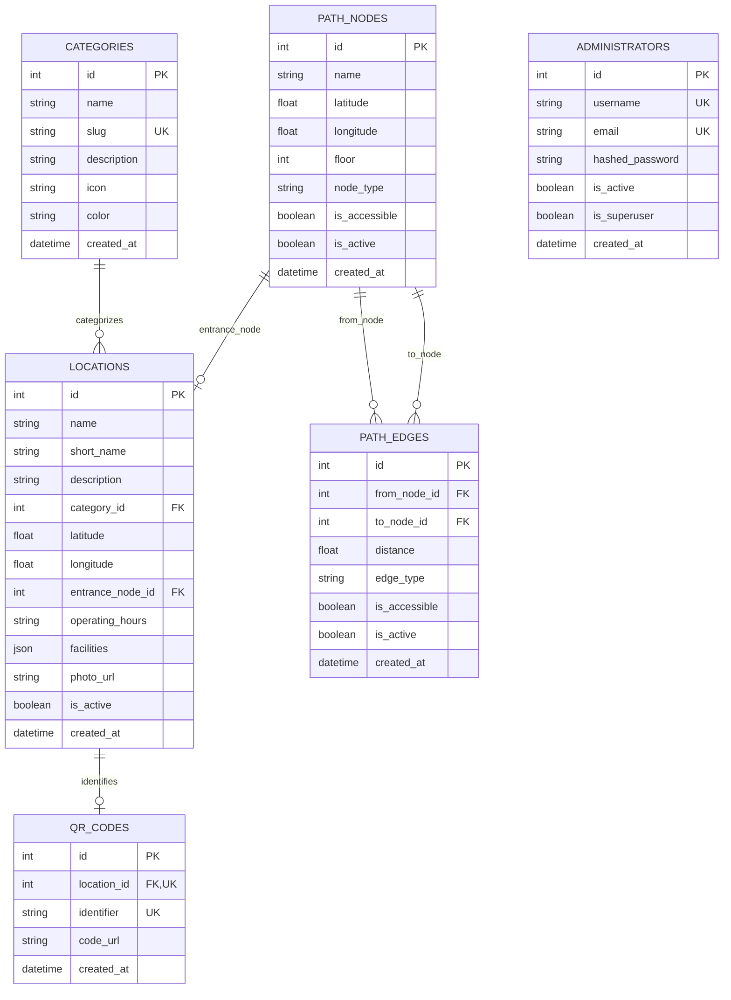

# Campus Navigator — Database Schema Reference

The database models are implemented using SQLAlchemy 2.0 and SQLite (in WAL mode) for local execution and automated testing, with full DDL and constraint parity for PostgreSQL + PostGIS production deployment.

---

## 1. Entity-Relationship Diagram

---

## 2. Table Specifications & Constraints

### 2.1 `categories`
Stores the 12 primary campus POI categories.
- `id`: Integer primary key.
- `name`: String, required.
- `slug`: String, unique (e.g., `academic`, `library`, `food`).
- `icon`: Lucide icon identifier (e.g., `GraduationCap`, `Utensils`, `BookOpen`).
- `color`: Hex color token matching the DESIGN.md palette (e.g., `#3B82F6`, `#10B981`).

### 2.2 `path_nodes`
Represents graph vertices: building entrances, pedestrian junctions, road crossings, and campus gates.
- `id`: Integer primary key.
- `latitude`, `longitude`: Float coordinates with check constraints:
  - Latitude: $-90.0 \le \phi \le 90.0$
  - Longitude: $-180.0 \le \lambda \le 180.0$
- `floor`: Integer level (default: 0).
- `node_type`: Enumeration (`junction`, `entrance`, `gate`, `landmark`).
- `is_accessible`: Boolean flag (true if wheelchair-accessible).

### 2.3 `path_edges`
Represents walkable graph segments between two nodes.
- `id`: Integer primary key.
- `from_node_id`, `to_node_id`: Foreign keys referencing `path_nodes.id`.
- `distance`: Float length in meters ($> 0.0$ check constraint).
- `edge_type`: Enumeration (`footpath`, `ramp`, `stairs`, `corridor`, `road`).
- `is_accessible`: Boolean flag (false for stairs, true for ramps/footpaths).
- `is_active`: Boolean flag (allows temporary pathway closures).
- **Constraints**: Enforces `from_node_id != to_node_id` (preventing self-loops) and unique bidirectional pairs.

### 2.4 `locations`
Represents campus buildings, facilities, and points of interest.
- `id`: Integer primary key.
- `name`: Full name (e.g., *APJ Abdul Kalam Block*).
- `category_id`: Foreign key referencing `categories.id`.
- `entrance_node_id`: Foreign key referencing `path_nodes.id` (snaps routing destination to this entrance).
- `facilities`: JSON list of feature tags (e.g., `["Wi-Fi", "Elevator", "Restroom"]`).
- `operating_hours`: String (e.g., `08:00 - 18:00` or `24/7`).
- `photo_url`: Optional uploaded photo path.

### 2.5 `qr_codes`
Maps printable physical QR stickers to database POIs.
- `id`: Integer primary key.
- `location_id`: Unique foreign key referencing `locations.id`.
- `identifier`: Non-guessable alphanumeric string (e.g., `LOC-001`).
- `code_url`: Deep-link target (`/q/LOC-001`).

### 2.6 `administrators`
Provides secure credentials for the visual graph editor and administrative studio.
- `id`: Integer primary key.
- `username`: Unique string.
- `hashed_password`: Passlib bcrypt-hashed password (12 rounds).
- `is_active`: Boolean flag.
